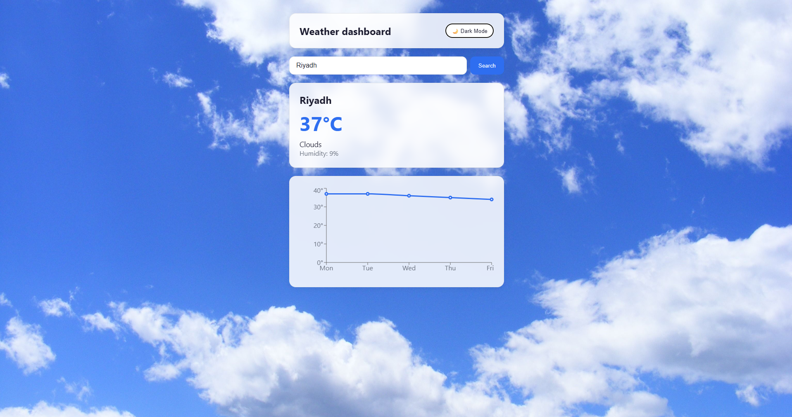
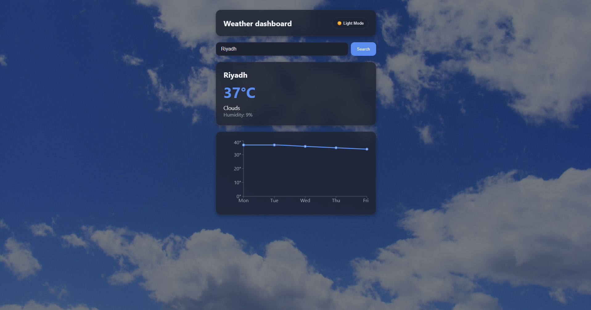

# Weather Dashboard

A responsive weather app built with React. Search for any city to see the current weather and a 5-day forecast, with a background that changes to match the conditions and a light/dark theme.





## Features

- Search any city and see temperature, condition and humidity
- 5-day temperature forecast chart (Recharts)
- Background image that changes with the weather (clear, clouds, rain, storm, snow)
- Light/dark theme, remembered between visits
- Loading and error states (e.g. city x not found)

## Tech stack

- React + Vite
- Recharts
- OpenWeather API (`/weather` and `/forecast`)
- Plain CSS with custom properties (no UI library)

## Run locally

```bash
git clone <your-repo-url>
cd weather-dashboard
npm install
cp .env.example .env     # then add your OpenWeather API key
npm run dev
```

Get a free key at [openweathermap.org](https://openweathermap.org/api).

## How it works

- **Data:** the current weather and the forecast are fetched in parallel with `Promise.all`. The forecast endpoint returns a reading every 3 hours, so I keep only the noon reading of each day to get one point per day.
- **Theming:** colors are CSS variables. Setting `data-theme` on the app wrapper switches the whole palette, and the choice is saved in `localStorage`.
- **Weather background:** a fixed layer behind the content gets a class from the weather condition (`weather-rain`, etc.). A semi-transparent overlay darkens it in dark mode, and cards use a blur effect to stay readable.
- **State:** `App` owns the data, loading and error state, and passes data down to presentational components (`SearchBar`, `WeatherCard`, `ForecastChart`).

## What I learned

- **Async state handling:** fetching data needs three states (data, loading, error). I used `try/catch/finally` so the loading state always resets, and `Promise.all` to fetch the current weather and the forecast in parallel.
- **Transforming API data:** the forecast endpoint returns a reading every 3 hours, so I filtered the noon reading of each day to get one clean data point per day for the chart.
- **CSS variables for theming:** a light/dark theme is just a different set of variable values. I first put `data-theme` on a wrapper while the background was on `body`, and nothing changed because variables only inherit downward. Moving the background onto the same element fixed it.
- **Layering and stacking contexts:** the weather background is a fixed layer behind the content. It needed `isolation: isolate` on the app wrapper, otherwise it rendered behind the wrapper's own background.
- **Third-party components and styling:** Recharts sets inline styles on its tooltip, so CSS classes could not override them. I passed the colors as props using CSS variables so the chart follows the theme.

## Possible improvements

- Move the API call to a serverless function so the API key is not exposed in the browser
- Search by geolocation
- Unit toggle (°C / °F)
- Tests for the data-mapping functions

## Credits

Background photos from pexels .
Weather data by [OpenWeather](https://openweathermap.org).